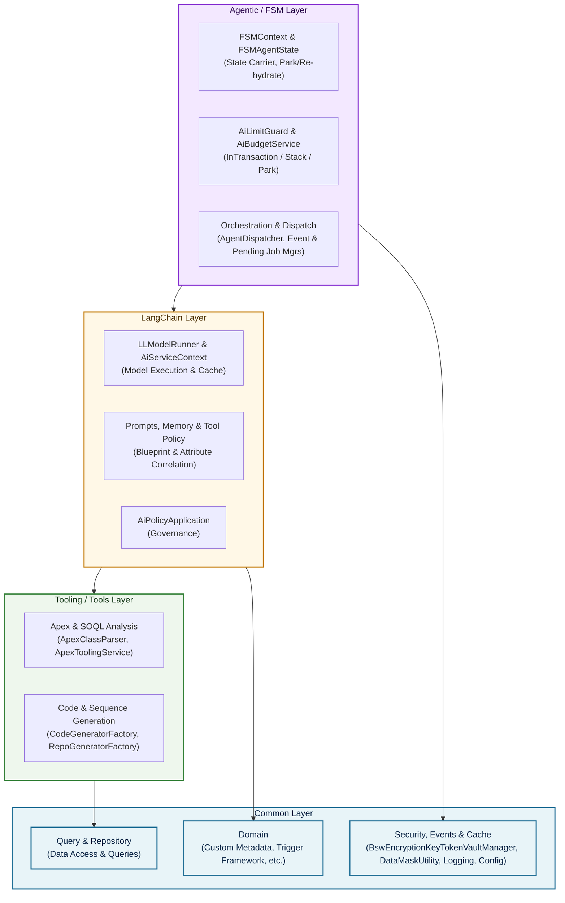
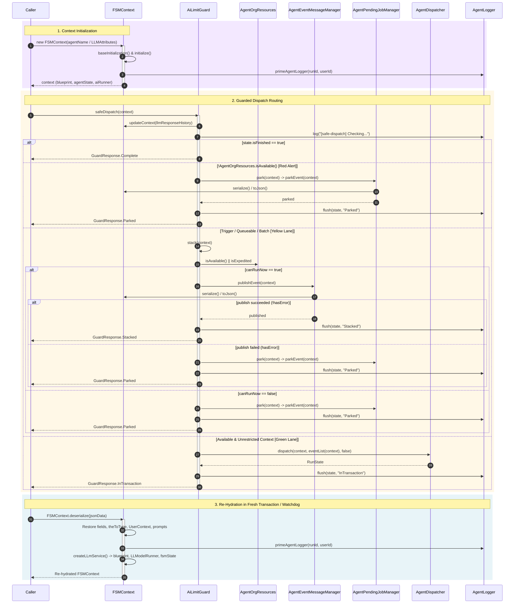

# Free-Agent

**Free-Agent** is a free AI agent and orchestration framework for the Salesforce platform built on a strict four-tier layered architecture (`Agentic / FSM` → `LangChain` → `Tooling / Tools` → `Common`). Higher tiers depend strictly downward on lower tiers and the shared `Common` base layer to keep responsibilities isolated, enforce governance, and manage Salesforce governor limits across multi-step agent execution.

---

## High-Level Architecture



---

## Layer Breakdown

- **Agentic / FSM (Top)**: Coordinates state machines, pipelines, supervisors, and dispatch routing. Uses `AiLimitGuard` to check org resource availability, restricted execution contexts (`Trigger.isExecuting`, `System.isQueueable()`, `System.isBatch()`), kill-switch settings, and priority budget caps (`BUDGET_SOFT_CAP` / `BUDGET_HARD_CAP`) to route execution across `InTransaction`, `Stacked` (Platform Event offload), `Parked` (`Agent_Pending_Job__c` persistence with automatic fallback from stacking), or `Complete`. Uses `FSMContext` (`serialize()` / `deserialize()`, including `theToTypeName` re-hydration for `transient` `Type` fields and `AgentLogger` priming) as the state carrier across runs.

- **LangChain**: Provides `LLModelRunner` and `AiServiceContext` for model execution and cache wiring, correlates agent blueprints with runtime attributes (`AgentBlueprint` / `LLMAttributes` / `prompts`), tracks interaction history (`llmResponseHistory`), and enforces governance via `AiPolicyApplication`.

- **Tooling / Tools**: Handles Salesforce/Apex static analysis (`ApexClassParser`, `ApexToolingService`), sequence diagram generation (`SequenceDiagramGenerator`), and template-driven code or repository generation (`CodeGeneratorFactory`, `RepoGeneratorFactory`).
- **Common (Full-Width Base)**: Serves as the shared foundational layer beneath all upper tiers, grouping **Query & Repository** (data access and queries), **Domain** (custom metadata handling, trigger framework, etc.), and **Security, Events & Cache** (`BswEncryptionKeyTokenVaultManager`, `DataMaskUtility`, caching, events, logging, and configuration).

---

## Dependency & Runtime Rules

1. **Strict Downward Dependencies**: `Agentic / FSM` depends on `LangChain`, `Tooling / Tools`, and `Common`; `LangChain` depends on `Tooling / Tools` and `Common`; `Tooling / Tools` depends only on `Common`; `Common` has zero upward dependencies on higher tiers.
2. **Governor-Limit Resilience**: Calling `AiAgentFSM.run()` invokes `AiLimitGuard.safeDispatch(FSMContext)` before dispatching steps—running synchronously in unrestricted transactions when resources are available, stacking via Platform Events in restricted contexts (`Trigger`, `Queueable`, `Batch`), or parking serialized `FSMContext` payloads for scheduled recovery when resources are constrained or event publishing fails.

3. **Stateless Re-Hydration**: `FSMContext` encapsulates prompts, variables, blueprint state, and tool specifications into a JSON-serializable payload so any transaction boundary (synchronous, Platform Event consumer, or scheduled watchdog) can restore the exact execution state and logger context (`runId`, `userId`).

---

## Guarded Dispatch & Re-Hydration Flow



---

## Setup & Deployment

### 1. Deploy in Strict Dependency Order

Deploy packages/source directories from `src` in bottom-up order so lower-tier dependencies are resolved before upper tiers compile:
//core jsonparse named tooling labels invoker datamask langChain aiSamples agent mcp

```bash
# 1. Common (Base Layer)
sf project deploy start --source-dir src/common

# 2. JSON Parser ( will deprecate )
sf project deploy start --source-dir src/jsonparse

# 3. Named Credentials (currently OpenAi & Gemmin, will get to Claude at some point)
sf project deploy start --source-dir src/named

# 4. Labels
sf project deploy start --source-dir src/labels

# 5. Invokers ( calling uderlying tools ( apex, flow, etc. Flow is a TBD)
sf project deploy start --source-dir src/invoker

# 6. DataMask ( encryption/decryption)
sf project deploy start --source-dir src/datamask

# 7. Tooling / Tools (reads all Apex classes looking for methods that can be used by LangChain)
sf project deploy start --source-dir src/tooling

# 8. LangChain ( Provides a similar feature as found in Langchain)
sf project deploy start --source-dir src/langChain

# 9. Agentic / FSM ( Provides a similar feature as found in LangGraph)
sf project deploy start --source-dir src/agentic

# 10. MCP ( Brave and SearchApi examples)
sf project deploy start --source-dir src/mcp

```

### 2. Configure Permissions & Automated Process (`autoproc`) User

1. Assign `BSW_AI_Permissions` and `BSW_Tooling_Access` (or the `BSW_Grant_Tooling_Access` custom permission) to administrators and developers who configure agents or run tooling utilities.
2. Assign `BSW_AI_Permissions` to the **Automated Process (`autoproc`)** user so Platform Event consumers and asynchronous agent transactions have full access to AI objects, custom metadata, and encryption services. Run the following in **Anonymous Apex**:

```apex
// 1. Get the Permission Set ID
PermissionSet ps = [SELECT Id FROM PermissionSet WHERE Name = 'BSW_AI_Permissions' LIMIT 1];

// 2. Get the Automated Process User ID
User autoProcUser = [SELECT Id FROM User WHERE Alias = 'autoproc' LIMIT 1];

// 3. Create the assignment
PermissionSetAssignment psa = new PermissionSetAssignment(
    AssigneeId = autoProcUser.Id,
    PermissionSetId = ps.Id
);

insert psa;

```

### 3. Seed Org GDPR & PII Encryption Configurations

Run the PII configuration seeder in **Anonymous Apex** so Free-Agent inspects your org's SObject definitions and registers fields marked for compliance (such as **GDPR**, **PII**, etc.) with the encryption/decryption and data-masking pipeline (`BswEncryptionKeyTokenVaultManager` / `DataMaskUtility`):

```apex
// Reads SObject definitions to register fields marked (GDPR, PII, etc.) for encryption/decryption
PiiConfigSeeder.seedAllOrgPiiConfigurations();

```

### 4. Configure Security, Providers & Watchdog

- **Encryption & Vault**: Initialize key material in `BswEncryptionKeyTokenVaultManager` and verify `DataMaskUtility` rules for sensitive payloads.
- **Named Credentials & Models**: Configure Named Credentials / Remote Site Settings for your target LLM providers and align default provider/model settings in `AiUserContext`.
- **Watchdog Scheduler**: Schedule `AiSupervisorJobScheduler` so parked jobs saved in `Agent_Pending_Job__c` by `AiLimitGuard.park(context)` are automatically recovered and re-hydrated when org resources recover.

---

## Usage Examples

### 1. Guarded Agent Execution (`AiAgentFSM` / LangGraph)

Use `AiAgentFSM` to orchestrate multi-step agents (such as `BswSupervisor`). Calling `fsm.run()` automatically routes execution through `AiLimitGuard.safeDispatch(FSMContext)` (`InTransaction`, `Stacked`, or `Parked`):

```apex
String userPrompt = 'Notify me if any high-value deal has not been updated in 2 weeks?';
String agentName = 'BswSupervisor';

// 1. Optional: "AiChatModelName" ensure when you specify a provide (i.e. openAI) a valid model
//    will be used. This is optional as each defined user/profile ( via custom settings) has
//    an assigned Provider/Model. The Org Wide Deafults can be applied overall
AiChatModelName result = AiChatModelNameFactory.instance()
    .create(AiConstants.GEMINI); // Or OpenAI ==> AiConstants.OPEN_AI

// 2. Build LLMAttributes with user query and target agent name
blsw.LLMAttributes attrs = blsw.LLMAttributes.builder()
    .providerName(result.provider()) // Or AiConstants.GEMINI
    .modelName(result.defaultAiModel()) // Or specify a model, e.g., 'gemini-2.5-flash'
    .agentName(agentName) // our agent name -- it is found in the AgentBlueprint
    .userPrompt(userPrompt) // The agent already has a system prompt, this allows various questions related to system prompt
    .userPromptName('SalesforceUser') // optional, various pre-defined prompts
    .cache(false) // when testing do not cache
    .dataMaskAttrs(LLMDataMaskAttributes.SOBJECT_MASK) // ensuring data from SObject ( with markings PII, GDPR) are masked
    .reasoningEffort('low') // optional
    .build();

// 3. Instantiate FSM (LangGraph) and run via AiLimitGuard.safeDispatch(FSMContext)
blsw.AiAgentFSM fsm = new blsw.AiAgentFSM(attrs);
blsw.AiAgentFSM.AIAgentFSMStatus status = fsm.run();

// Output can be passed to formatters (CSV, HTML, XML, etc.)
System.debug('++STATUS -- success+>' + status.success);
System.debug('++STATUS -- run summary+>' + status.runSummary);

```

### 2. Direct Synchronous Model Invocation (`LLModelRunner.syncInvoke`)

If you want to invoke the model synchronously without FSM guard routing, initialize `FSMContext` and call `ctx.aiRunner.syncInvoke(attrs)` directly. When running outside the FSM lifecycle, release buffered log writes with `AgentLogger.holdWrite(false)` and call `AgentLogger.flush(...)` so buffered log entries are persisted:

```apex
// Just a simple example to run synchronously. Use this after testing if interaction is
// within CPU and Governor Limits. It be used in place of Item 3 ( above)
blsw.FSMContext ctx = new blsw.FSMContext(attrs);
blsw.AiResponse response = ctx.aiRunner.syncInvoke(attrs);

if (response != null) {
    System.debug('+++AiResponse Token+:' + response.tokenUsage());
    System.debug('+++AiResponse Text+:' + response.content().text());
    System.debug('+++AiResponse HasError+:' + response.hasError());
    System.debug('+++AiResponse Tools+:' + response.content().tools());
}

// Release held log writes and flush buffered log items
blsw.AgentLogger.holdWrite(false);
blsw.AgentLogger.flush('Demo Done');

```

---

## Configuration & Custom Metadata

### Custom Metadata Types

| Layer               | Metadata Type                               | Purpose                                                                                                                               |
| ------------------- | ------------------------------------------- | ------------------------------------------------------------------------------------------------------------------------------------- |
| **Agentic / FSM**   | `Agent_Blueprint__mdt`                      | Defines agent state graphs (`currentStateKey`), prompts, tool bindings, and runtime environment settings.                             |
|                     |
| **LangChain**       | `AI_Policy__mdt` / `LLM_Provider__mdt`      | Configures governance rules (`AiPolicyApplication`), model endpoints, caching flags, and attribute correlation.                       |
|                     |
| **Tooling / Tools** | `Code_Generator__mdt`                       | Stores template definitions (e.g., `CQRS_Templates`) used by `CodeGeneratorFactory` to generate Apex classes.                         |
| **Tooling / Tools** | `Code_Repository_Generator__mdt`            | Stores repository templates (e.g., `Repo_Templates`) used by `RepoGeneratorFactory`.                                                  |
| **Tooling / Tools** | `BSW_UI_Apex_Flow__mdt`                     | Configures visual flow and sequence diagram inspection behaviors in the Tooling UI.                                                   |
| **Common**          | `Mapper_Config__mdt` / Environment Settings | Maps `fromType` to `toType` DTO translations (`IMapTranslator`) and runtime environment modes (`Test`, `Debug`, `Production`, `All`). |
|                     |

### Operational Guard & Budget Controls (`AiLimitGuard`)

| Control             | Mechanism                                                         | Behavior                                                                                                                              |
| ------------------- | ----------------------------------------------------------------- | ------------------------------------------------------------------------------------------------------------------------------------- |
| **Kill Switch**     | `CustomSettingResourceMgr.customSetting().killSwitchActive()`     | Immediately halts non-`HIGH_PRIORITY` agent execution when enabled.                                                                   |
|                     |
| **Soft Budget Cap** | `AiBudgetService.BUDGET_SOFT_CAP`                                 | Throttles standard-priority requests once daily spend percentage reaches the soft threshold.                                          |
|                     |
| **Hard Budget Cap** | `AiBudgetService.BUDGET_HARD_CAP`                                 | Enforces an upper daily spend ceiling for `HIGH_PRIORITY` agent runs.                                                                 |
|                     |
| **Resource Sensor** | `AgentOrgResources.isAvailable()`                                 | Parks execution (`GuardResponse.Parked`) when org governor buffers are low.                                                           |
|                     |
| **Context Sensor**  | `Trigger.isExecuting`, `System.isQueueable()`, `System.isBatch()` | Offloads execution to a fresh transaction via Platform Event (`GuardResponse.Stacked`), falling back to `Parked` if publishing fails. |
|                     |

---

## License & Terms of Use

Copyright 2023–2026 **BluSoftwave LLC**.

- **Permitted Use**: Organizations and individuals are free to install, use, and modify **Free-Agent** internally within their Salesforce environments without prior consent.
- **Commercial Packaging Restriction**: You **may not** package, redistribute, or sell **Free-Agent** (in whole or in part) as part of a commercial product or paid offering without prior written consent from **BluSoftwave LLC**.
- **Base License**: Subject to the commercial packaging restriction above, source code is provided under the [Apache License, Version 2.0](http://www.apache.org/licenses/LICENSE-2.0) on an **"AS IS" BASIS**, WITHOUT WARRANTIES OR CONDITIONS OF ANY KIND, either express or implied.
